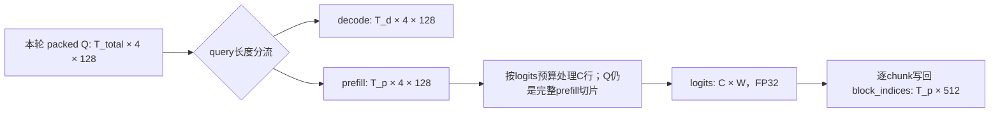

# QSA prefill：上游 benchmark、我们的 benchmark 与推理 shape 对照

## 结论与证据边界

2026-10-16 更新：当前默认性能矩阵扩展为 **22组**：上游12组 + 推理长度候选8组 +
缓存布局变体2组。常规 benchmark 的 core/comprehensive 与 H800 默认
`inference-prefill` suite 共用定义；`--suite upstream-prefill` 仍保留原有12组。
新增10组均按源码规则构造，布局参数尚无真实部署 trace，不能视为已实测生产分布。
参数、来源和运行回传命令见[22组矩阵](qsa_prefill_inference_perf_matrix.md)。
下文38组、EXTRA tuple 和50项目录保留为历史测量记录；功能测试覆盖继续保留。

研究对象为官方 **Qwen/Qwen3.8-Flash-Next**，不是泛指所有 QSA 模型。
官方配置确定索引器 H=4、D=128、KV heads=1、ratio=4、token_topk=2048，
因此本算子的 compressed block Top-K=512。索引器投影是 ReplicatedLinear，
不会因为 TP=2/4/8 就把 H=4 除成 2/1；主注意力的 H=24、D=256 是另一组参数。

此前已回传 benchmark 共 **38+12=50 个参数场景**；部分张量 shape 相同，
但 dtype、max_seq_len 上界或工作区预算不同。这 50 个场景均有算子级 H800 报告，
不等于采集到了 50 种真实服务输入。本轮的“推理证实”来自官方配置、发布源码、
调用链和实际执行上游元数据分流函数；**没有运行完整模型或采集真实流量的 shape 频次**。
因此能确认输入规则与可达边界，不能据此断言哪种请求长度最常见。

- 官方模型 revision：`de4b8e4d43b917e7706784d8bb445c9af86a3540`。
- 本地 benchmark 的固定参考：`7a877ae34dcf4a7d46de08eb16db4699e1e0047c`。
- vLLM **v0.31.0 标签实际是** `db9527a46873454610df6dbedf79a36d6bf1a7f6`，不是上述参考提交。
  两者的 NVIDIA indexer 调用模块和 qsa_indexer 算子模块逐字相同；本报告依赖的 11 个关键元数据/缓存/默认配置函数
  AST 一致。以下推理源码链接统一指向 v0.31.0，避免混淆版本。
- [结构化目录及证据](qsa_prefill_shape_catalog.json)包含 50 个场景的实测输入 shape、
  stride、分块、报告提交、配置 SHA256、源码 Git blob 和两版本分流验证结果。

## 1. vLLM 公开性能矩阵与我们的对应矩阵

来源：[引入独立 prefill/decode indexer 的 PR #54513](https://github.com/vllm-project/vllm/pull/54513)。
其性能表提供四种 query 布局 × 三个 Prefix，page size=196，硬件 GB300。
表中没有披露完整输入生成脚本、H/D、dtype 和计时协议。我们对齐公开的布局、Prefix、page，
选用官方模型对应的 BF16/H=4/D=128，在 H800 测量；不宣称逐字复现其原始输入或 GB300 延迟。

这里 K=1024 token；Prefix 是当前 query 之前的原始 token 数。
`S_i=Prefix_i+query_len_i`，压缩长度 `ceil(S_i/4)`，不是把 Prefix 直接当压缩后 context。

| 上游 query 布局 | 上游 Prefix | 我们 query 长度 | 我们总 Q shape | 我们每请求压缩长度 | Page | 覆盖 |
| --- | --- | --- | --- | --- | ---: | --- |
| 1×8K | 8K | [8192] | [8192, 4, 128] | 4096 | 196 | 已测 |
| 1×8K | 50K | [8192] | [8192, 4, 128] | 14848 | 196 | 已测 |
| 1×8K | 100K | [8192] | [8192, 4, 128] | 27648 | 196 | 已测 |
| 1×16K | 8K | [16384] | [16384, 4, 128] | 6144 | 196 | 已测 |
| 1×16K | 50K | [16384] | [16384, 4, 128] | 16896 | 196 | 已测 |
| 1×16K | 100K | [16384] | [16384, 4, 128] | 29696 | 196 | 已测 |
| 2×8K | 8K | [8192, 8192] | [16384, 4, 128] | 4096 | 196 | 已测 |
| 2×8K | 50K | [8192, 8192] | [16384, 4, 128] | 14848 | 196 | 已测 |
| 2×8K | 100K | [8192, 8192] | [16384, 4, 128] | 27648 | 196 | 已测 |
| 4×4K | 8K | [4096, 4096, 4096, 4096] | [16384, 4, 128] | 3072 | 196 | 已测 |
| 4×4K | 50K | [4096, 4096, 4096, 4096] | [16384, 4, 128] | 13824 | 196 | 已测 |
| 4×4K | 100K | [4096, 4096, 4096, 4096] | [16384, 4, 128] | 26624 | 196 | 已测 |

这 12 组是新增的 `upstream-prefill` suite，全部通过；报告
`88dee1c4be295fb2b2a43162e440963b6528af4a`。
它们代表长 prefill 的性能矩阵，但相同前缀、等长请求、紧凑缓存仍是简化条件，
不是生产调度结果的概率分布。

## 2. 我们其余 38 个场景的来源与定位

| 类别 | 数量 | 主要参数 | 与官方模型推理的关系 |
| --- | ---: | --- | --- |
| 自建 core | 6 | H4/D128；N=1或4，单请求Q=1/64/128/2048；page16/64 | 部分是合理短 prefill；Q=1通常走 decode；K=1024/2048非模型默认 |
| 上游 prefill 正确性 fixture | 6 | Q长度[3,33]；H4/D128；page24；BF16/FP8；slack0/1792；默认或强制单行分块 | 来自正确性测试，不是 PR 长 prefill 性能表 |
| 无可见完整块 | 1 | Q=[2,4,8]；visible=0 | D=8为边界测试，不是此模型 D=128 |
| 36-row H/D 参数化 | 8 | [3,33]；(1,32)/(3,64)/(5,96)/(8,256) × BF16/FP8 | 检查通用参数支持；不是该 checkpoint 的索引器参数 |
| 单 query H/D 扫描 | 12 | Q行数1；再加(4,128)/(17,33)，共6对 × 两dtype | API/局部优化探针；普通推理更应先检查 decode 分流 |
| padded/空请求 | 1 | Q长度[4,0,5]；H4/D128；显式visible；非连续stride | metadata/layout压力；visible不是连续因果位置生成的序列 |
| 1 MiB 分块尾块 | 4 | [39,34]→32/32/9；[33,32]→32/32/1；两dtype | 强制工作区压力，非默认512 MiB；单行chunk不等于整次只有1query |

其中上游 prefill 正确性原矩阵是 dtype×slack×force_chunk 共8种。
最近的38组保留4个默认分块组合和2个slack=0单行组合；slack=1792的单行组合
在常规 pytest benchmark 中定义，但没有纳入这38组。正确性覆盖与性能 active set 应分开描述。

自建 core 的六个 tuple，字段为 `(请求数, 每请求Q, 压缩后context, page, block_K)`：

| 请求数 | 每请求Q | 压缩后context | 原始max_seq_len上界 | Page | block_K |
| ---: | ---: | ---: | ---: | ---: | ---: |
| 1 | 1 | 2048 | 8192 | 16 | 512 |
| 1 | 64 | 4096 | 16384 | 16 | 512 |
| 4 | 128 | 16384 | 65536 | 64 | 512 |
| 1 | 2048 | 65536 | 262144 | 64 | 512 |
| 1 | 64 | 4096 | 16384 | 16 | 1024 |
| 1 | 64 | 8192 | 32768 | 16 | 2048 |

变更前，常规 `benchmark/test_qsa_select_paged_prefill_perf.py` 还定义了未纳入这 50 组的
EXTRA tuples：`(1,7,1537,16,512)`、`(4,16,8193,64,1024)`、
`(1,512,65536,16,1024)`、`(4,512,65536,64,2048)`，以及 comprehensive 参数化
中的 `(H,D)=(12,192)` 等。不能把“文件中存在”写成“最近50组均已跑过”。

38组数据来自报告 `573a3aa6a1c8c9957f6d1ac86de949c126d71c89`，该报告保留先前同GPU的合格记录。
完整 tensor shape/stride 在后面的50项附表与 JSON 中，不只给概括范围。

## 3. 推理中实际进入这个算子的 tensor

设 `N_p` 为分流后的 prefill 请求数，`T_p=Σ q_i` 是本轮这些请求的新 query token 数；
`G` 是整个压缩缓存池的物理页数，`P` 是每页压缩 key 行数，`M` 是 page table 容量。

| 参数 | 官方模型推理 shape / dtype | 证实依据 |
| --- | --- | --- |
| Q | `[T_p,4,128]`，默认BF16，显式索引器FP8时为E4M3FN | 配置 + indexer复制投影、reshape、cast/输出分配 |
| compressed K cache | `[G,P,1,128]`，与Q同dtype | 压缩cache spec与cache绑定 |
| page_table | `[N_p,M]`，int32；M可以大于当前活跃页数 | 从批次表切出prefill请求行，保留列容量 |
| query_start_loc | `[N_p+1]`，int32；首值可非0 | 混合批次切片保留decode行偏移 |
| visible_blocks | `[T_p]`，int32；按每token逻辑位置计算 | metadata kernel |
| block_indices | `[T_p,512]`，int32 | indexer_budget/ratio = 2048/4 |
| 内部 logits | `[C,W]`，FP32 | W按context上界确定；C受工作区预算约束 |

注意：主注意力配置里的 `head_dim=256`、`num_attention_heads=24` **不属于此索引器**。
同样，FP8权重模型或主KV-cache量化选项，不自动等于 `indexer_kv_dtype=fp8`。
当前 indexer 显式以 `resolve_indexer_kv_dtype("bf16")` 解析默认值；FP8是单独配置的路径。

索引器的4个头不按TP分片。下表只比较头的来源，不承诺所有并行/量化组合都能部署：

| TP | 主注意力本地query heads=24/TP | 本索引器query heads | 本索引器D |
| ---: | ---: | ---: | ---: |
| 1 | 24 | 4 | 128 |
| 2 | 12 | 4 | 128 |
| 4 | 6 | 4 | 128 |
| 8 | 3 | 4 | 128 |

证据：[官方固定版 config.json](https://huggingface.co/Qwen/Qwen3.8-Flash-Next/blob/de4b8e4d43b917e7706784d8bb445c9af86a3540/config.json)、[indexer构造/复制投影](https://github.com/vllm-project/vllm/blob/db9527a46873454610df6dbedf79a36d6bf1a7f6/vllm/models/qwen4_exp/nvidia/indexer_qsa.py#L110)、[dtype选择](https://github.com/vllm-project/vllm/blob/db9527a46873454610df6dbedf79a36d6bf1a7f6/vllm/models/qwen4_exp/nvidia/indexer_qsa.py#L150)、[prefill调用](https://github.com/vllm-project/vllm/blob/db9527a46873454610df6dbedf79a36d6bf1a7f6/vllm/models/qwen4_exp/nvidia/indexer_qsa.py#L400)。

## 4. shape 如何从推理调度产生



### 调度分块与评分工作区分块是两件事

`max_num_batched_tokens` 限制模型这一步调度多少 token；512 MiB logits预算限制
进入算子后的评分子调用一次处理多少行。前者改变Q的T，后者使用同一个完整Q tensor
和query_offset，只改变所处理的C行与logits形状；不是把两种“chunk”混为一谈。

对H800 80 GiB、普通默认模式且没有相关用户覆盖/特殊DP/MM设置，v0.31默认表给出：
离线 LLM 类预算16384，OpenAI server预算8192。throughput模式、禁用chunked prefill、
显式启动参数等会改变这些值。它们是预算，不是保证每步都填满的实际T。

因此，若实际预算为8192，`1×16K`、`2×8K`、`4×4K` 的总T=16384不能在同一普通调度步
全部进入本算子；需要更大预算，或者由调度器拆到多个时间步。不能把服务并发数直接当作
一个算子batch的请求数，也不能把16K prompt长度直接当作本轮query长度。

例如，50K=51200 token的新prompt在预算8192时，可拆成6个8192和最后2048 token的步骤；
这是预算示例，实际还受其他请求、Mamba对齐和调度策略影响。随步骤推进，前缀与可见压缩块数增长。

证据：[预算默认表](https://github.com/vllm-project/vllm/blob/db9527a46873454610df6dbedf79a36d6bf1a7f6/vllm/engine/arg_utils.py#L2829)、[调度截断](https://github.com/vllm-project/vllm/blob/db9527a46873454610df6dbedf79a36d6bf1a7f6/vllm/v1/core/sched/scheduler.py#L670)、[全局调度token数断言](https://github.com/vllm-project/vllm/blob/db9527a46873454610df6dbedf79a36d6bf1a7f6/vllm/v1/core/sched/scheduler.py#L1353)。

### decode/prefill 分流：1-query不是常规prefill代表，但也不是绝对不可达

普通非MTP阈值为1，单token短请求通常走decode。标准MTP3验证路径阈值通常为4；
某些V1 parallel-drafting配置会更宽，不能无条件写死为4。
QSA还要求decode请求的query长度一致，因此同批不等长的短请求可能进入prefill路径。
实际执行上游分流函数（两版本结果一致）得到：

| 重排后的query长度 | decode阈值 | decode处理token数 | prefill处理token数 | 含义 |
| --- | ---: | ---: | ---: | --- |
| [1] | 1 | 1 | 0 | 普通单token不调用prefill算子 |
| [3,33] | 1 | 0 | 36 | 非MTP时，上游正确性fixture可整体进入prefill |
| [1,33] | 1 | 1 | 33 | prefill切片的query_start_loc首值为1 |
| [4,4] | 4 | 8 | 0 | 均匀MTP验证用decode |
| [4,1] | 4 | 4 | 1 | 保持decode均匀性，后面的1token可走prefill |
| [4,3,33] | 4 | 4 | 36 | 短请求和长prefill可共享prefill分区 |

验证方式是对下载校验后的原函数AST执行，使用CPU标量/list适配器提供元数据Tensor操作；
不是复制一份分流算法，也不是GPU模型推理。JSON保留原函数AST哈希和输入/输出。
这证实 `[1,4,128]` 的prefill输入有条件可达，但不能推出它是主流性能负载。
此外，大T请求在工作区切分后产生单行尾块，是另一种路径，不能用整次T=1的结果代替。

证据：[QSA metadata构造](https://github.com/vllm-project/vllm/blob/db9527a46873454610df6dbedf79a36d6bf1a7f6/vllm/models/qwen4_exp/common/qsa_cache.py#L648)、[分流原函数](https://github.com/vllm-project/vllm/blob/db9527a46873454610df6dbedf79a36d6bf1a7f6/vllm/v1/attention/backends/utils.py#L799)、[MTP阈值规则](https://github.com/vllm-project/vllm/blob/db9527a46873454610df6dbedf79a36d6bf1a7f6/vllm/v1/attention/backend.py#L579)。

### Prefix、可见长度、page与stride

对请求i，本轮query长度为q_i，逻辑sequence长度为S_i，则第j行位置与可见压缩块数为：

```text
position(i,j) = S_i - q_i + j
visible(i,j)  = max(0, min(floor((position(i,j)+1)/4), floor(S_i/4)))
```

模型配置不固定page=196。压缩cache的spec使用ratio=4，状态行数来自实际kernel block
覆盖的原始token数除以4；一般写作P=B_kernel/4。196对应B_kernel=784的情况，
是上游性能表的非MTP生产例子；TP、MTP、缓存布局和对齐配置下必须以实际k_cache.shape[1]为准。
不要把主KV块覆盖的原始token数与本算子page内的压缩行数当成同一个量。
特别是，直接设置 vLLM 的 `--block-size=196` 不等于本算子 `page_size=196`；
要核对解析后的 cache spec/kernel block 和实际缓存张量，而不是复用同一个数字。

G是全局物理缓存池，而我们的微基准通常只分配本例需要的页。实际page table保留runner分配的M列，
不保证M=ceil(本请求活跃压缩长度/P)。缓存view还使用planner提供的block_stride/layer_stride，
跨页stride可能含其他层的页面或padding，不保证stride(0)=P*128。
我们的长12组使用紧凑缓存；旧mixed_padded仅做有限padding，尚不能替代实际跨层大stride测试。

证据：[位置与visible计算](https://github.com/vllm-project/vllm/blob/db9527a46873454610df6dbedf79a36d6bf1a7f6/vllm/models/qwen4_exp/common/qsa_cache.py#L251)、[压缩cache spec](https://github.com/vllm-project/vllm/blob/db9527a46873454610df6dbedf79a36d6bf1a7f6/vllm/models/qwen4_exp/common/qsa_cache.py#L862)、[cache状态数](https://github.com/vllm-project/vllm/blob/db9527a46873454610df6dbedf79a36d6bf1a7f6/vllm/v1/kv_cache_interface.py#L204)、[page table容量](https://github.com/vllm-project/vllm/blob/db9527a46873454610df6dbedf79a36d6bf1a7f6/vllm/v1/worker/block_table.py#L112)、[缓存as_strided布局](https://github.com/vllm-project/vllm/blob/db9527a46873454610df6dbedf79a36d6bf1a7f6/vllm/v1/kv_cache_interface.py#L353)。

### 混合批次的max_seq_len可由长decode决定

QSA metadata保留整个common batch的max_seq_len；indexer把它直接传给prefill算子，
没有重新计算prefill子批次的最大值。因此：

```text
W = min(M*P, max(64, align_up(ceil(S_max_batch/4), 64)))
C = min(T_p, max(1, floor(logits_budget_bytes / (4*W))))
```

示例：一个decode请求的S=204800，加一个prefill请求q=4096、S=8192，
在缓存容量足够、预算512 MiB时，prefill Q是[4096,4,128]，但W可达到51200，
C=2621，评分分成2621/1475行。若只看prefill自己的S会错误预测W=2048、整块4096行。
这类“长decode+短prefill”对评分网格、工作区与chunk都有影响；当前12组等长纯prefill没有覆盖。
这是按源码推导的可达元数据示例，不是采集到的实际服务记录。

证据：[保留common max_seq_len](https://github.com/vllm-project/vllm/blob/db9527a46873454610df6dbedf79a36d6bf1a7f6/vllm/models/qwen4_exp/common/qsa_cache.py#L718)、[prefill入参](https://github.com/vllm-project/vllm/blob/db9527a46873454610df6dbedf79a36d6bf1a7f6/vllm/models/qwen4_exp/nvidia/indexer_qsa.py#L428)。

## 5. 对后续benchmark与优化的影响

1. 主性能矩阵应以H4/D128、block_K512为中心；H/D扫描继续保留为通用性回归，不能按TP场景解释。
2. 同时保留8K与16K的T预算，但标明后者需要部署预算允许；增加异长请求和scheduler尾步，而不只有等长批次。
3. 增加纯prefill与长decode混合的prefill切片，覆盖非零starts基址和全批context上界。
4. 使用实际cache的P、stride与page table列容量作为参数；紧凑page196只是已验证基线之一。
5. BF16作为当前默认索引器路径；显式FP8路径单独报告。FP8权重不能作为选择FP8索引器benchmark的证据。
6. 继续按用户要求以同编译器、排除Top-K的kernel模式加速比验收；保留现有50场景的原始数据。

本轮只研究/归档，不修改生产算子、Top-K、调优配置或benchmark行为。
若需要真实流量的shape权重，下一层证据应是部署启动配置加算子入口metadata trace，
仅记录shape/stride、各请求query长度、context上界、page与分流信息，再按调用频次汇总。

## 附表：50个已回传场景的实际tensor shape

Q/cache/table形状与chunk来自H800报告；各请求query长度/压缩context由对应builder核对，
不是从GPU Tensor值再次读取。JSON还保留stride、token_topk、上界、报告来源与压力测试分类。
以下 `×` 是维度分隔，chunk行数用 `/` 分隔；相同tensor shape的参数变体仍分别列出。

| 场景 | Q | Cache | Page table | Dtype | MB预算 | W | 评分chunk行数 |
| --- | --- | --- | --- | --- | ---: | --- | --- |
| core_0 | 1×4×128 | 128×16×1×128 | 1×128 | bfloat16 | 512 | 2048 | 1 |
| core_1 | 64×4×128 | 256×16×1×128 | 1×256 | bfloat16 | 512 | 4096 | 64 |
| core_2 | 512×4×128 | 1024×64×1×128 | 4×256 | bfloat16 | 512 | 16384 | 512 |
| core_3 | 2048×4×128 | 1024×64×1×128 | 1×1024 | bfloat16 | 512 | 65536 | 2048 |
| core_4 | 64×4×128 | 256×16×1×128 | 1×256 | bfloat16 | 512 | 4096 | 64 |
| core_5 | 64×4×128 | 512×16×1×128 | 1×512 | bfloat16 | 512 | 8192 | 64 |
| upstream_bfloat16_s0 | 36×4×128 | 128×24×1×128 | 2×64 | bfloat16 | 512 | 1280 | 36 |
| upstream_bfloat16_s1792 | 36×4×128 | 128×24×1×128 | 2×64 | bfloat16 | 512 | 1536 | 36 |
| upstream_float8_e4m3fn_s0 | 36×4×128 | 128×24×1×128 | 2×64 | float8_e4m3fn | 512 | 1280 | 36 |
| upstream_float8_e4m3fn_s1792 | 36×4×128 | 128×24×1×128 | 2×64 | float8_e4m3fn | 512 | 1536 | 36 |
| zero_visible | 2×4×8 | 1×16×1×8 | 1×1 | bfloat16 | 512 | N/A | N/A |
| hd_1_32_bfloat16 | 36×1×32 | 384×16×1×32 | 2×256 | bfloat16 | 512 | 4096 | 36 |
| hd_3_64_bfloat16 | 36×3×64 | 384×16×1×64 | 2×256 | bfloat16 | 512 | 4096 | 36 |
| hd_5_96_bfloat16 | 36×5×96 | 384×16×1×96 | 2×256 | bfloat16 | 512 | 4096 | 36 |
| hd_8_256_bfloat16 | 36×8×256 | 384×16×1×256 | 2×256 | bfloat16 | 512 | 4096 | 36 |
| one_row_bfloat16 | 36×4×128 | 128×24×1×128 | 2×64 | bfloat16 | 0 | 1280 | 1/1/1/1/1/1/1/1/1/1/1/1/1/1/1/1/1/1/1/1/1/1/1/1/1/1/1/1/1/1/1/1/1/1/1/1 |
| hd_1_32_float8_e4m3fn | 36×1×32 | 384×16×1×32 | 2×256 | float8_e4m3fn | 512 | 4096 | 36 |
| hd_3_64_float8_e4m3fn | 36×3×64 | 384×16×1×64 | 2×256 | float8_e4m3fn | 512 | 4096 | 36 |
| hd_5_96_float8_e4m3fn | 36×5×96 | 384×16×1×96 | 2×256 | float8_e4m3fn | 512 | 4096 | 36 |
| hd_8_256_float8_e4m3fn | 36×8×256 | 384×16×1×256 | 2×256 | float8_e4m3fn | 512 | 4096 | 36 |
| one_row_float8_e4m3fn | 36×4×128 | 128×24×1×128 | 2×64 | float8_e4m3fn | 0 | 1280 | 1/1/1/1/1/1/1/1/1/1/1/1/1/1/1/1/1/1/1/1/1/1/1/1/1/1/1/1/1/1/1/1/1/1/1/1 |
| mixed_padded | 9×4×128 | 163×16×1×128 | 3×97 | bfloat16 | 512 | 1552 | 9 |
| tail_chunk_bfloat16 | 73×4×128 | 768×16×1×128 | 2×512 | bfloat16 | 1 | 8192 | 32/32/9 |
| tail_chunk_float8_e4m3fn | 73×4×128 | 768×16×1×128 | 2×512 | float8_e4m3fn | 1 | 8192 | 32/32/9 |
| single_1_32_bfloat16 | 1×1×32 | 512×16×1×32 | 1×512 | bfloat16 | 512 | 8192 | 1 |
| single_3_64_bfloat16 | 1×3×64 | 512×16×1×64 | 1×512 | bfloat16 | 512 | 8192 | 1 |
| single_4_128_bfloat16 | 1×4×128 | 512×16×1×128 | 1×512 | bfloat16 | 512 | 8192 | 1 |
| single_5_96_bfloat16 | 1×5×96 | 512×16×1×96 | 1×512 | bfloat16 | 512 | 8192 | 1 |
| single_8_256_bfloat16 | 1×8×256 | 512×16×1×256 | 1×512 | bfloat16 | 512 | 8192 | 1 |
| single_17_33_bfloat16 | 1×17×33 | 512×16×1×33 | 1×512 | bfloat16 | 512 | 8192 | 1 |
| tail_one_bfloat16 | 65×4×128 | 768×16×1×128 | 2×512 | bfloat16 | 1 | 8192 | 32/32/1 |
| single_1_32_float8_e4m3fn | 1×1×32 | 512×16×1×32 | 1×512 | float8_e4m3fn | 512 | 8192 | 1 |
| single_3_64_float8_e4m3fn | 1×3×64 | 512×16×1×64 | 1×512 | float8_e4m3fn | 512 | 8192 | 1 |
| single_4_128_float8_e4m3fn | 1×4×128 | 512×16×1×128 | 1×512 | float8_e4m3fn | 512 | 8192 | 1 |
| single_5_96_float8_e4m3fn | 1×5×96 | 512×16×1×96 | 1×512 | float8_e4m3fn | 512 | 8192 | 1 |
| single_8_256_float8_e4m3fn | 1×8×256 | 512×16×1×256 | 1×512 | float8_e4m3fn | 512 | 8192 | 1 |
| single_17_33_float8_e4m3fn | 1×17×33 | 512×16×1×33 | 1×512 | float8_e4m3fn | 512 | 8192 | 1 |
| tail_one_float8_e4m3fn | 65×4×128 | 768×16×1×128 | 2×512 | float8_e4m3fn | 1 | 8192 | 32/32/1 |
| perf_n1_q8192_p8192_bfloat16 | 8192×4×128 | 21×196×1×128 | 1×21 | bfloat16 | 512 | 4096 | 8192 |
| perf_n1_q8192_p51200_bfloat16 | 8192×4×128 | 76×196×1×128 | 1×76 | bfloat16 | 512 | 14848 | 8192 |
| perf_n1_q8192_p102400_bfloat16 | 8192×4×128 | 142×196×1×128 | 1×142 | bfloat16 | 512 | 27648 | 4854/3338 |
| perf_n1_q16384_p8192_bfloat16 | 16384×4×128 | 32×196×1×128 | 1×32 | bfloat16 | 512 | 6144 | 16384 |
| perf_n1_q16384_p51200_bfloat16 | 16384×4×128 | 87×196×1×128 | 1×87 | bfloat16 | 512 | 16896 | 7943/7943/498 |
| perf_n1_q16384_p102400_bfloat16 | 16384×4×128 | 152×196×1×128 | 1×152 | bfloat16 | 512 | 29696 | 4519/4519/4519/2827 |
| perf_n2_q8192_p8192_bfloat16 | 16384×4×128 | 42×196×1×128 | 2×21 | bfloat16 | 512 | 4096 | 16384 |
| perf_n2_q8192_p51200_bfloat16 | 16384×4×128 | 152×196×1×128 | 2×76 | bfloat16 | 512 | 14848 | 9039/7345 |
| perf_n2_q8192_p102400_bfloat16 | 16384×4×128 | 284×196×1×128 | 2×142 | bfloat16 | 512 | 27648 | 4854/4854/4854/1822 |
| perf_n4_q4096_p8192_bfloat16 | 16384×4×128 | 64×196×1×128 | 4×16 | bfloat16 | 512 | 3072 | 16384 |
| perf_n4_q4096_p51200_bfloat16 | 16384×4×128 | 284×196×1×128 | 4×71 | bfloat16 | 512 | 13824 | 9709/6675 |
| perf_n4_q4096_p102400_bfloat16 | 16384×4×128 | 544×196×1×128 | 4×136 | bfloat16 | 512 | 26624 | 5041/5041/5041/1261 |
